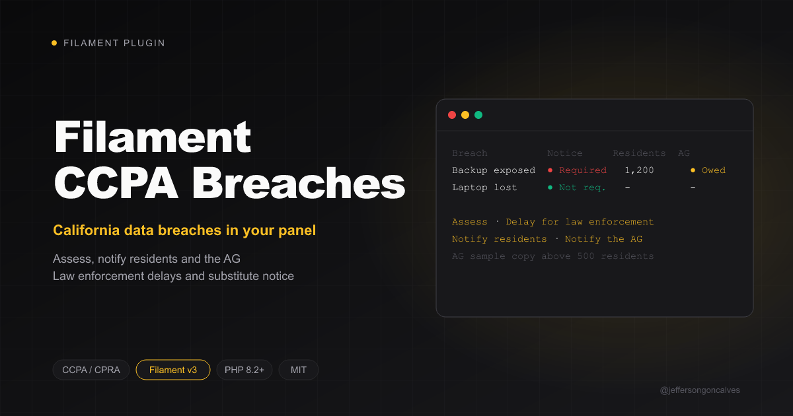

<div class="filament-hidden">



</div>

# Filament CCPA Breaches

[](https://packagist.org/packages/jeffersongoncalves/filament-ccpa-breaches)
[](https://github.com/jeffersongoncalves/filament-ccpa-breaches/actions?query=workflow%3Atests+branch%3A2.x)
[](https://github.com/jeffersongoncalves/filament-ccpa-breaches/actions?query=workflow%3A"Fix+PHP+code+styling"+branch%3A2.x)
[](https://packagist.org/packages/jeffersongoncalves/filament-ccpa-breaches)
[](LICENSE.md)

The Filament panel for [laravel-ccpa-breaches](https://github.com/jeffersongoncalves/laravel-ccpa-breaches): register breaches of the security of the system and notify California residents in the most expedient time possible and without unreasonable delay (Cal. Civ. Code §1798.82).

## Features

- Register a breach with what happened, the information involved and the number of California residents affected. California sets no fixed deadline, so the plugin uses the notice target of `ccpa-breaches.target_days` (30 days by default), counted from the discovery date. That date is locked afterwards.
- **Assess:** record whether residents must be notified (unencrypted personal information, or encrypted data with its key) and why.
- **Delay for law enforcement:** when an agency says the notice would impede a criminal investigation (§1798.82(c)). A delayed breach is not overdue.
- **Notify residents**, with the substitute notice option (§1798.82(j)), and **notify the Attorney General** when more than 500 residents were notified (§1798.82(f)). Then **close**.
- Status badge (open, notice pending, overdue, closed), "Notice pending" and "Overdue" filters, and a navigation badge with pending breaches (red when one is overdue).
- 19 languages.

## Compatibility

| Plugin Version                                                                | Filament |
|-------------------------------------------------------------------------------|----------|
| [1.x](https://github.com/jeffersongoncalves/filament-ccpa-breaches/tree/1.x) | 3.x      |
| [2.x](https://github.com/jeffersongoncalves/filament-ccpa-breaches/tree/2.x) | 4.x      |
| [3.x](https://github.com/jeffersongoncalves/filament-ccpa-breaches/tree/3.x) | 5.x      |

## Installation

You can install the package via composer:

```bash
composer require jeffersongoncalves/filament-ccpa-breaches:"^2.0"
php artisan vendor:publish --tag="ccpa-breaches-migrations"
php artisan migrate
```

Upgrading from an earlier release? Publish and run the migrations again: laravel-ccpa-breaches 1.1 adds the complement columns.

## Usage

```php
use JeffersonGoncalves\Filament\CcpaBreaches\CcpaBreachesPlugin;

public function panel(Panel $panel): Panel
{
    return $panel
        ->plugins([
            CcpaBreachesPlugin::make()
                ->navigationGroup('CCPA')             // default: no group
                ->navigationSort(40)
                ->navigationIcon('heroicon-o-exclamation-triangle')
                ->slug('breaches'),
        ]);
}
```

All fluent methods are optional. The deadline (72 hours) is configured in laravel-ccpa-breaches' `ccpa-breaches` config. Schedule `ccpa:breaches-overdue` to be alerted outside the panel.

> The resource has no authorization of its own: register it only on panels whose users handle breaches, or add a policy for `JeffersonGoncalves\CcpaBreaches\Models\Breach`. Records younger than 5 years can't be deleted.

## Testing

```bash
composer test
```

## Changelog

Please see [CHANGELOG](CHANGELOG.md) for more information on what has changed recently.

## Contributing

Please see [CONTRIBUTING](.github/CONTRIBUTING.md) for details.

## Security Vulnerabilities

Please review [our security policy](../../security/policy) on how to report security vulnerabilities.

## Credits

- [Jefferson Gonçalves](https://github.com/jeffersongoncalves)
- [All Contributors](../../contributors)

## License

The MIT License (MIT). Please see [License File](LICENSE.md) for more information.
